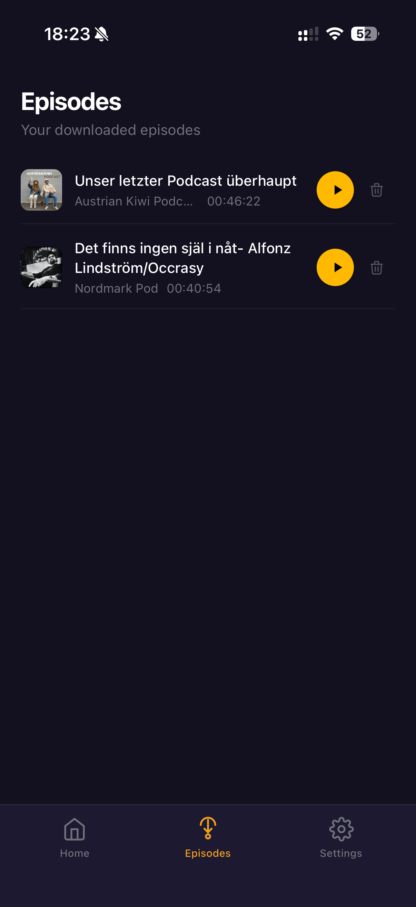
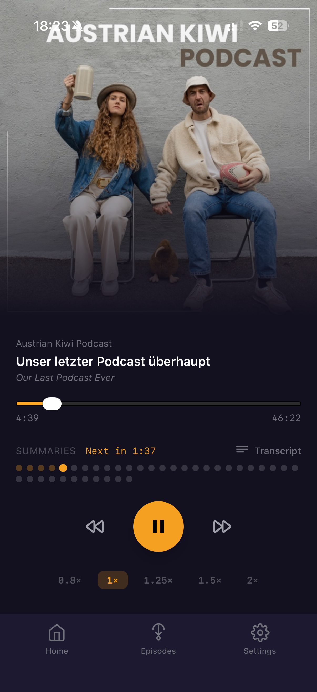
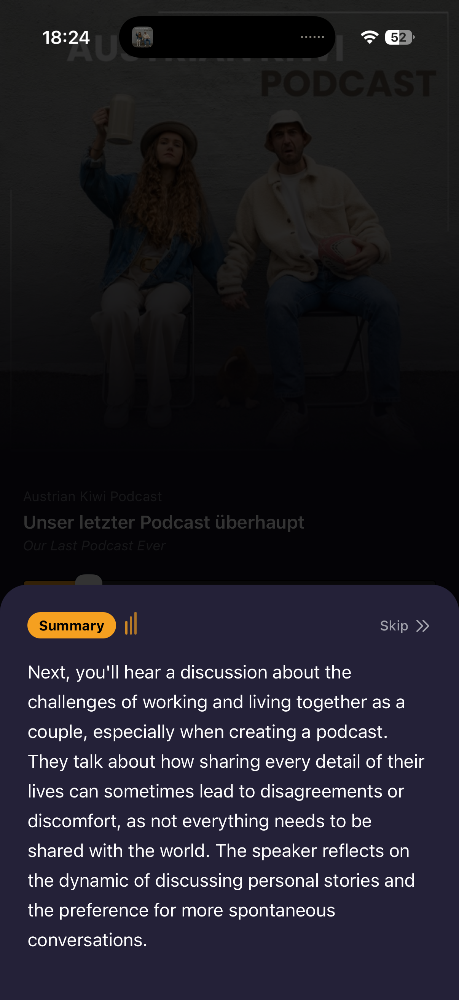
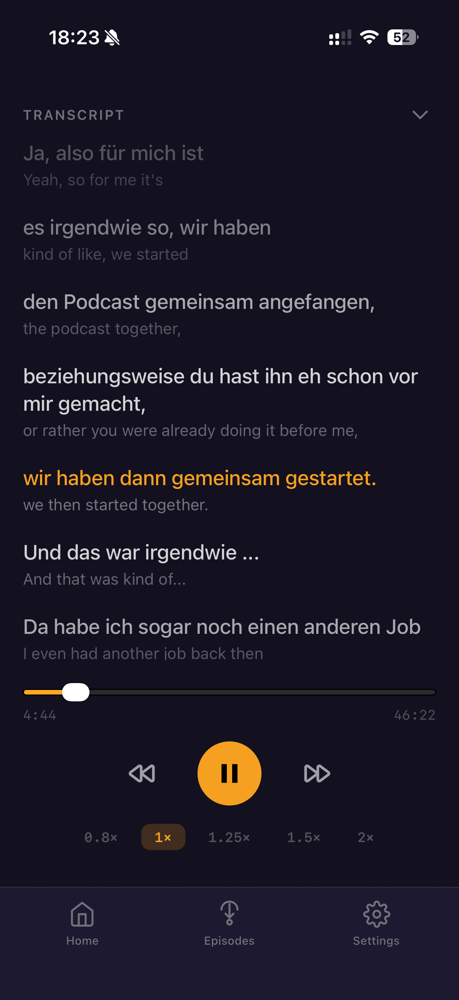
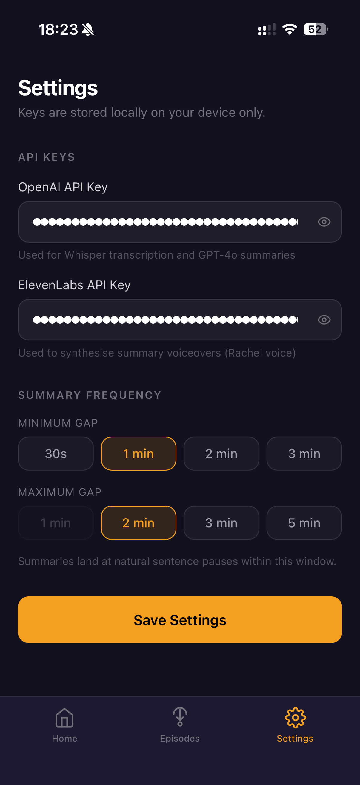

# Polycast

**Learn language through your favourite podcasts.**

Polycast is a mobile-first progressive web app for language learners. It processes foreign-language podcast episodes through an AI pipeline that inserts brief, natural-sounding English summaries at strategic pauses — so you stay immersed in the target language while still following along.

---

## Try it — add to your iPhone

Polycast is a PWA (Progressive Web App), so there's nothing to download. It installs directly from Safari and feels like a native app.

1. Open **Safari** on your iPhone (must be Safari, not Chrome)
2. Go to **[https://polycast-self.vercel.app](https://polycast-self.vercel.app)**
3. Tap the **Share** button (the box with an arrow at the bottom of the screen)
4. Scroll down and tap **"Add to Home Screen"**
5. Tap **Add**

Polycast now appears on your home screen with its icon and runs fullscreen. You'll need OpenAI and ElevenLabs API keys to process episodes — see [API keys](#api-keys) below.

---

## Screenshots

| Home | Episodes | Setup | Processing |
|:---:|:---:|:---:|:---:|
|  |  |  |  |

| Player | Summary | Transcript | Settings |
|:---:|:---:|:---:|:---:|
|  |  |  |  |

---

## Features

- **Background downloads** — tap the download icon on any episode, pick your language and summary frequency, and Polycast processes it in the background
- **AI summaries at natural breakpoints** — spoken English summaries insert themselves at sentence-boundary pauses, fading the episode audio in and out smoothly
- **Skip or pause summaries** — tap Skip in the summary card to jump straight back to the episode
- **Episodes library** — a dedicated tab shows all your downloaded episodes; tap to play, swipe to delete
- **Dual-language transcript** — scrolling transcript in the original language with English translations; tap any line to seek
- **Resume from where you left off** — playback position is saved automatically
- **Lock screen controls** — play, pause, and skip via the iOS/Android media controls even with the screen locked
- **Offline playback** — once processed, episodes are cached in IndexedDB and play without a connection
- **No backend** — entirely client-side; your API keys stay on your device

---

## How to use

### 1. Add your API keys

Go to the **Settings tab** (bottom nav) and enter:
- **OpenAI key** — used for Whisper transcription, GPT-4o translation and summarization
- **ElevenLabs key** — used for the spoken summary voiceovers

Keys are stored in your browser's localStorage and sent only to the respective APIs.

### 2. Find a podcast

Tap the **Search tab** and search for any podcast by name. Tap a result to open it. Tap **Follow** to pin it to your home screen.

### 3. Download an episode

In the podcast episode list, tap the **download icon** on any episode. A sheet appears where you pick:
- **Language** — the language spoken in the episode
- **Summary gap** — how often you want an English summary (e.g. every 1–3 minutes)

Tap **Start** and Polycast processes the episode in the background through 6 stages: Download → Transcribe → Translate → Summarise → Voiceover → Cache. Keep the app open during processing (your screen won't auto-lock).

### 4. Listen

Once downloaded, tap the episode from the **Episodes tab** or directly from the podcast page. The player shows:
- A scrubber with summary markers as dots
- The episode and podcast artwork
- Skip back/forward 15 seconds
- Playback speed (0.8× – 2×)
- A **Transcript** button (top right of the summaries row) for the dual-language view

When a summary fires, a card slides up with the spoken English text and a **Skip →→** button if you'd rather jump back to the episode immediately.

---

## How it works (technical)

1. **Download** — fetches the episode audio with CORS proxy fallbacks
2. **Transcribe** — sends audio to OpenAI Whisper (`whisper-1`) in up to 20 MB chunks, stitching segments with estimated time offsets
3. **Translate** — GPT-4o translates transcript segments in batches of 80 lines and the episode title
4. **Summarise** — GPT-4o generates an intro summary (episode overview + first-section preview) and a preview at each detected breakpoint
5. **Voiceover** — ElevenLabs synthesises each summary as an MP3
6. **Cache** — the full `ProcessedEpisode` object (transcript, summaries, audio blobs) is stored in IndexedDB

At playback, a dual-audio engine runs a 250 ms tick loop: when the episode reaches a summary timestamp, it fades the episode audio out, plays the summary clip, then fades back in. All processing retries automatically (4 attempts, exponential backoff) and the entire pipeline is abortable.

---

## Tech stack

| Layer | Technology |
|---|---|
| UI | React 19, TypeScript |
| Routing | TanStack React Router (file-based) |
| Styling | Tailwind CSS 4 |
| Build | Vite 8 |
| Storage | localStorage + IndexedDB (`idb`) |
| Transcription | OpenAI Whisper |
| Translation & Summarisation | OpenAI GPT-4o |
| Text-to-speech | ElevenLabs |
| Podcast search | Apple iTunes API |
| Deployment | Vercel |

---

## API keys

You need two API keys — both have free tiers that will take you a long way:

| Service | What it's used for | Get one |
|---|---|---|
| OpenAI | Whisper transcription + GPT-4o summaries and translation | [platform.openai.com](https://platform.openai.com/) |
| ElevenLabs | Spoken summary voiceovers | [elevenlabs.io](https://elevenlabs.io/) |

Cost per episode is roughly $0.05–$0.30 depending on length, split between transcription and TTS.

---

## Run it locally

```bash
pnpm install
pnpm dev
```

Open `http://localhost:5173`. For a production build:

```bash
pnpm build
pnpm preview
```

Enter your API keys in the **Settings** tab once the app is running.

---

## Project structure

```
src/
├── lib/
│   ├── pipeline.ts        # Orchestrator: download → transcribe → translate → summarise → TTS → cache
│   ├── audio-engine.ts    # Dual-audio playback engine with summary injection, fading, and iOS priming
│   ├── download-queue.ts  # Module-level background download queue with progress tracking
│   ├── summarize.ts       # GPT-4o summarisation, translation, and breakpoint detection
│   ├── whisper.ts         # Whisper transcription with chunked upload for large files
│   ├── tts.ts             # ElevenLabs TTS synthesis
│   ├── rss.ts             # RSS feed fetching with Atom fallback and CORS proxy chain
│   ├── itunes.ts          # iTunes podcast search
│   └── storage.ts         # localStorage + IndexedDB abstraction
└── routes/
    ├── index.tsx           # Home: followed podcasts + search
    ├── episodes.tsx        # Episodes library: downloads in progress + cached episodes
    ├── podcast.$id.tsx     # Podcast detail, episode list, and download sheet
    ├── episode.$id.tsx     # Episode setup, processing screen, and player
    └── settings.tsx        # API key and preference configuration
```

---

## License

MIT
